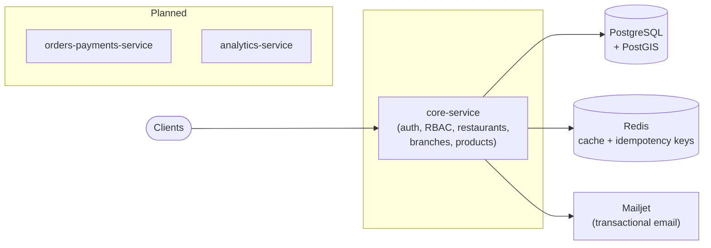

# Bite Flow

A restaurant delivery backend built as a set of Node.js / TypeScript microservices. The project is a hands-on showcase of backend engineering and system design: multi-tenant authorization, geospatial queries, caching, idempotency, layered architecture and production-minded cross-cutting concerns.

## Architecture



| Service | Responsibility | Status |
| --- | --- | --- |
| [`core-service`](./core-service) | Identity & auth, restaurants, branches, products, staff RBAC, delivery-area search | ✅ Done |
| `orders-payments-service` | Orders and payments | 🚧 Planned |
| `analytics-service` | Analytics | 🚧 Planned |

## Backend and system-design concepts demonstrated

Everything below is implemented in [`core-service`](./core-service); links point to the code.

### Architecture & design
| Concept | How it's applied |
| --- | --- |
| **Microservice decomposition** | One service per responsibility, each with its own config, database schema and README |
| **Layered architecture** | Controller → service → repository in every feature module, so HTTP, business rules and SQL stay separate |
| **Dependency injection / IoC** | `tsyringe` container wires controllers, services and repositories ([`lib/di`](./core-service/src/lib/di)) |
| **Ports & adapters** | Cache and email sit behind interfaces with Redis and Mailjet implementations, so providers can be swapped without touching business code ([`pkg/`](./core-service/src/pkg)) |
| **Twelve-factor configuration** | All settings come from environment variables, validated with Zod at startup so the app fails fast on bad config ([`lib/config/env.ts`](./core-service/src/lib/config/env.ts)) |

### Security & access control
| Concept | How it's applied |
| --- | --- |
| **Role-based access control** | Roles and permissions live in the database and are seeded by a migration; permissions use `resource:action` naming such as `core:product:create` ([`lib/auth/rbac.ts`](./core-service/src/lib/auth/rbac.ts)) |
| **Multi-tenancy** | Restaurant-scoped authorization: a user can only act inside their own restaurant |
| **Fine-grained, branch-level authorization** | Staff can be limited to specific branches, with owner and system-admin bypass rules |
| **Least privilege** | Separate `owner`, `branch_manager` and `staff` roles with progressively narrower permissions |
| **Token-based authentication** | Short-lived JWT access tokens and refresh tokens delivered through HTTP-only cookies |
| **Secure credential handling** | bcrypt password hashing; password-reset one-time codes stored only as hashes and expiring after 10 minutes |
| **Invitation-based onboarding** | Staff are invited by email and join through an accept-invite flow |
| **HTTP hardening** | Helmet security headers and configurable CORS origins |

### Data & performance
| Concept | How it's applied |
| --- | --- |
| **Geospatial queries** | PostGIS `geography` column (generated, stored) with a GiST index; `ST_DWithin` finds branches whose delivery radius covers a customer's location ([`restaurant-branch.repo.ts`](./core-service/src/app/restaurant-branch/repository/restaurant-branch.repo.ts)) |
| **Relational modelling** | Foreign keys, enums, indexes and generated columns, managed through versioned migrations ([`migrations/`](./core-service/src/migrations)) |
| **Response caching** | Redis-backed caching middleware with TTL and `X-Cache: HIT/MISS` header ([`lib/cache/withCache.ts`](./core-service/src/lib/cache/withCache.ts)) |
| **In-memory caching with TTL** | Role permissions cached per process to avoid a database lookup on every request |
| **Cursor-based pagination** | Reusable helper with sorting and filtering for list endpoints ([`lib/http/pagination`](./core-service/src/lib/http/pagination/cursor-pagination.ts)) |
| **Connection pooling** | Configurable PostgreSQL pool through Knex |

### Reliability & operability
| Concept | How it's applied |
| --- | --- |
| **Idempotency** | `Idempotency-Key` middleware backed by Redis so retried requests return the original response ([`lib/idempotency`](./core-service/src/lib/idempotency/idempotency.ts)) |
| **Centralised error handling** | Typed application errors mapped to consistent HTTP responses ([`lib/error`](./core-service/src/lib/error)) |
| **Request tracing** | Correlation ID attached to every request and its logs |
| **Structured logging** | Central logger shared across modules |
| **Input validation** | DTOs validated with `class-validator`; Zod for configuration |
| **Health checks** | `/api/health` verifies database connectivity |
| **Graceful shutdown** | SIGINT/SIGTERM drain in-flight requests and close the database pool ([`server.ts`](./core-service/src/server.ts)) |

## Tech stack

Node.js · TypeScript · Express 5 · PostgreSQL · PostGIS · Knex · Redis (`ioredis`) · tsyringe · Zod · class-validator · JWT · bcrypt · Mailjet

## Repository layout

```
bite-flow/
├── core-service/              # setup, API reference and design notes in its README
├── orders-payments-service/   # planned
└── analytics-service/         # planned
```

## Getting started

Each service is independent, with its own README, `.env.example` and setup steps. Start with [`core-service`](./core-service/README.md).

## Roadmap (planned)

- **Orders & payments service**, including a stricter idempotency implementation for payment operations
- **Analytics service**
- Automated tests, Docker Compose for local setup, OpenAPI documentation
