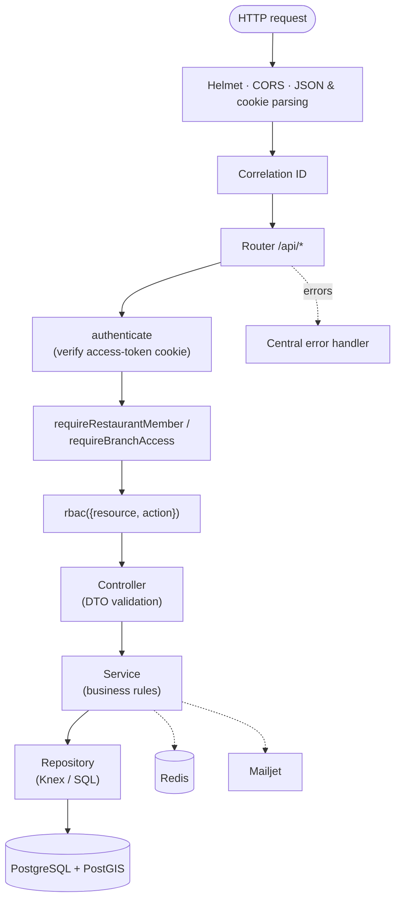
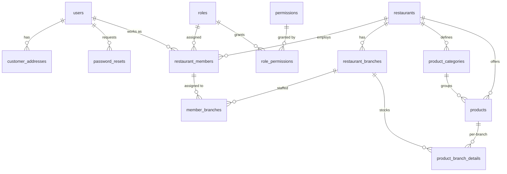

# Core Service

The foundation service of **Bite Flow**. It owns identity, users, customer addresses, members, authentication, the restaurant catalogue (restaurants, branches, products), delivery-area search, and the multi-level authorization that decides who can do what inside a restaurant.

**Highlights**

- Cookie-based JWT authentication with refresh tokens and a hashed one-time-code password reset
- Database-backed RBAC (`resource:action` permissions) with restaurant- and branch-level scoping
- Geospatial "who delivers to me?" search using PostGIS (`geography`, GiST index, `ST_DWithin`)
- Redis response caching and `Idempotency-Key` support
- Layered architecture with dependency injection and swappable infrastructure adapters

## Contents

[Features](#features) · [Architecture](#architecture) · [Data model](#data-model) · [Authorization](#authorization-model) · [API reference](#api-reference) · [Getting started](#getting-started) · [Configuration](#configuration) · [Design decisions](#design-decisions) · [Limitations & roadmap](#known-limitations)

## Features

- **Authentication**: register, login and refresh. Access and refresh tokens are issued as HTTP-only cookies. Passwords are hashed with bcrypt.
- **Password reset**: a one-time code is emailed through Mailjet. Only a hash of the code is stored, and it expires after 10 minutes.
- **RBAC**: restaurant roles `owner`, `branch_manager` and `staff` map to fine-grained permissions stored in the database. System admins may bypass some permission checks.
- **Branch-scoped access**: staff can be assigned to specific branches and are restricted to them.
- **Staff management**: invite members by email, change roles, assign branches, remove members. Invited users join through an accept-invite flow.
- **Restaurants, branches and products**: per-branch price, stock and availability for each product; product categories; soft-deleted products.
- **Nearby-branch search**: finds active branches whose delivery radius covers a coordinate.
- **Customer addresses**: CRUD for saved addresses.
- **Cursor pagination and filtering**: reusable helper for list endpoints.
- **Cross-cutting concerns**: Zod-validated environment, class-validator DTOs, centralised error handling, request correlation IDs, structured logging, Helmet, CORS, health check, graceful shutdown.

## Architecture

### Request pipeline



Public routes skip the authentication and authorization steps. Cached routes check Redis right after routing and return early on a hit.

### Project structure

```
src/
├── app/                      # feature modules: controller → service → repository
│   ├── auth/  user/  customer-address/
│   ├── restaurant/  restaurant-branch/  product/
│   ├── rbac/                 # members, roles, permissions
│   └── health/
├── lib/                      # cross-cutting code
│   ├── auth/                 # authenticate guard, rbac + branch-access middleware
│   ├── cache/  idempotency/  di/  config/  http/  logger/  ...
├── pkg/                      # adapters behind interfaces (Redis cache, Mailjet email)
└── migrations/               # Knex migrations: schema, trigger, RBAC seed data
```

Each feature module has the same layers: **controller** (HTTP and validation), **service** (business rules and authorization decisions), **repository** (SQL through Knex). Dependencies are wired with tsyringe, and infrastructure (cache, email) sits behind interfaces so it can be replaced without touching business code.

## Data model



Notable schema choices:

- `restaurant_branches.location` is a **generated, stored `geography(point, 4326)`** column derived from longitude/latitude, with a **GiST index** for fast radius queries.
- A **database trigger** creates a `product_branch_details` row (price 0, stock 0, unavailable) for every branch of the restaurant whenever a product is created, so each branch opts in to selling it.
- Products are **soft-deleted** (`deleted_at`).
- Integrity is enforced in the database: foreign keys, `UNIQUE (restaurant_id, user_id)` on members, `UNIQUE (branch_id, product_id)` on branch details, a `CHECK` on member status, and `ON DELETE CASCADE` for membership data.
- Permissions are rows (`resource`, `action`) linked to roles through `role_permissions`, seeded by a migration.

## Authorization model

**System roles:** `customer`, `delivery_agent`, `restaurant_user`, `system_admin`.

**Restaurant roles and permissions** (for `restaurant_user`):

| Permission | owner | branch_manager | staff |
| --- | :---: | :---: | :---: |
| `core:product:read` | ✅ | ✅ | ✅ |
| `core:product:create` | ✅ | ✅ | |
| `core:product:update` | ✅ | ✅ | |
| `core:member:read` | ✅ | ✅ | ✅ |
| `core:member:create` | ✅ | | |
| `core:member:update` | ✅ | | |
| `core:member:delete` | ✅ | | |
| `core:branch:create` | ✅ | | |
| `core:branch:update` | ✅ | ✅ | |
| `core:restaurant:update` | ✅ | | |

Checks are layered: **authenticate** (who are you?) → **restaurant membership** (is this your restaurant?) → **branch access** (is this one of your branches?) → **permission** (is your role allowed this action?). System admins pass the membership, branch and permission checks if the endpoints allow system admins. Some admin-only actions are enforced in the service layer.

## API reference

Base path: `/api`. Authentication uses the `access_token` HTTP-only cookie set at login.

### Health and auth

| Method | Endpoint | Access |
| --- | --- | --- |
| GET | `/health` | Public (checks DB connectivity) |
| POST | `/auth/register` | Public |
| POST | `/auth/login` | Public |
| POST | `/auth/forget-password` | Public, requires `Idempotency-Key` header |
| POST | `/auth/reset-password` | Public (email + one-time code) |
| GET | `/auth/refresh` | Refresh-token cookie |
| POST | `/auth/accept-invite` | Public (invitation) |

### Users and addresses

| Method | Endpoint | Access |
| --- | --- | --- |
| GET, PATCH | `/user/me` | Authenticated |
| GET, POST | `/customer/addresses` | Authenticated |
| PATCH, DELETE | `/customer/addresses/:addressId` | Authenticated |

### Restaurants and branches

| Method | Endpoint | Access |
| --- | --- | --- |
| GET | `/restaurant`, `/restaurant/:restaurantId` | Public |
| POST | `/restaurant` | System admin |
| PATCH | `/restaurant/:restaurantId` | Member + `core:restaurant:update` |
| PATCH | `/restaurant/:restaurantId/status` | System admin |
| GET | `/branches/nearby?lng=&lat=` | Public, cached 1 h |
| GET | `/restaurants/:restaurantId/branches` | Public |
| POST | `/restaurants/:restaurantId/branches` | Member + `core:branch:create` |
| PATCH | `/branches/:branchId` | Branch access + `core:branch:update` |
| PATCH | `/branches/:branchId/status` | System admin |

### Products

| Method | Endpoint | Access |
| --- | --- | --- |
| GET | `/restaurants/:restaurantId/categories` | Public |
| GET | `/branches/:branchId/products` | Public |
| GET | `/products/:id` | Public |
| GET | `/restaurants/:restaurantId/products` | Member + `core:product:read` |
| POST | `/restaurants/:restaurantId/products` | Member + `core:product:create` |
| PATCH | `/products/:productId` | Branch access + `core:product:update` |

### Members (RBAC)

| Method | Endpoint | Access |
| --- | --- | --- |
| GET | `/roles/:roleName/permissions` | Public |
| GET | `/restaurants/:restaurantId/members` | Member + `core:member:read` |
| POST | `/restaurants/:restaurantId/members` | Member + `core:member:create` |
| PATCH | `/restaurants/:restaurantId/members/:memberId` | Member + `core:member:update` |
| DELETE | `/restaurants/:restaurantId/members/:memberId` | Member + `core:member:delete` |
| PUT | `/restaurants/:restaurantId/members/:memberId/branches` | Member + `core:member:update` |

### Example requests

```bash
# Log in and keep the auth cookies
curl -i -X POST http://localhost:3000/api/auth/login \
  -H "Content-Type: application/json" \
  -c cookies.txt \
  -d '{"email": "you@example.com", "password": "YourPassword1"}'

# Authenticated request using the cookie
curl http://localhost:3000/api/user/me -b cookies.txt

# Branches that deliver to a coordinate (cached; see the X-Cache header)
curl -i "http://localhost:3000/api/branches/nearby?lng=29.9187&lat=31.2001"
```

## Getting started

### Prerequisites

- Node.js (current LTS)
- PostgreSQL with the **PostGIS** extension available
- Redis
- A Mailjet account (API key and secret): the app validates these at startup

### Setup

```bash
git clone https://github.com/alexanderkamal/bite-flow.git
cd bite-flow/core-service
npm install
cp .env.example .env      # then fill in your own values
```

Create the database and run the migrations. They create the schema, enable PostGIS and seed the roles and permissions:

```bash
npx knex migrate:latest --knexfile src/lib/knex/knexfile.ts
```

Start the service:

```bash
npm run dev               # watch mode
npm run build && npm start   # compiled
```

Health check: `GET http://localhost:3000/api/health`

### Scripts

| Script | What it does |
| --- | --- |
| `npm run dev` | Runs the service with `tsx` in watch mode |
| `npm run build` | Compiles TypeScript to `dist/` |
| `npm start` | Runs the compiled service |

## Configuration

Copy [`.env.example`](./.env.example) to `.env`. Values without a default are required.

| Variable | Default | Description |
| --- | --- | --- |
| `PORT` | `3000` | HTTP port |
| `NODE_ENV` | `development` | `production` turns on `secure` cookies |
| `CORS_ORIGINS` | `http://localhost:3000` | Comma-separated allowed origins |
| `DB_HOST`, `DB_PORT`, `DB_USER` | `localhost`, `5432`, `postgres` | PostgreSQL connection |
| `DB_PASSWORD`, `DB_NAME` | required | PostgreSQL credentials and database |
| `DB_POOL_MAX` | `10` | Connection pool size |
| `DB_MIGRATION_DIR`, `DB_MIGRATION_EXTENSION` | `src/migrations`, empty | Knex migration settings |
| `ACCESS_TOKEN_SECRET`, `REFRESH_TOKEN_SECRET` | required | JWT signing secrets |
| `ACCESS_TOKEN_EXPIRES_IN`, `REFRESH_TOKEN_EXPIRES_IN` | `1H`, `7d` | Token lifetimes |
| `REDIS_HOST`, `REDIS_PORT`, `REDIS_PASSWORD` | `localhost`, `6379`, empty | Redis connection |
| `MAILJET_API_KEY`, `MAILJET_SECRET_KEY` | required | Mailjet credentials |
| `MAILJET_FROM_EMAIL`, `MAILJET_FROM_NAME` | required | Sender identity for emails |

## Design decisions

- **Permissions as data, not code.** Roles and `resource:action` permissions live in tables, so changing what a role may do is a data change rather than a redeploy. The `core:` prefix namespaces permissions per service, so later services can add their own.
- **Layered permission checks.** Membership, branch and permission checks are separate middleware, so each route states exactly what it needs and the checks stay reusable.
- **In-memory permission cache.** Role permissions are cached per process for one hour to avoid a database lookup on every authenticated request. The trade-off is that a permission change can take up to an hour to apply on each instance. A shared Redis cache with explicit invalidation would remove that delay.
- **Cache-aside at the HTTP layer.** `withCache` serves identical read requests from Redis and falls through to the database on a miss, setting `X-Cache: HIT/MISS` for observability. Entries are keyed by method and full URL, so identical coordinates share an entry; rounding coordinates would raise the hit rate.
- **PostGIS `geography` over manual distance maths.** Distances are computed in metres on a sphere and served by a spatial index, and each branch carries its own delivery radius.
- **Refresh token scoped by path.** The refresh cookie is only sent to `/api/auth/refresh`, which limits its exposure. Both tokens are HTTP-only, so scripts in the browser can't read them.
- **Hashed one-time codes.** Password-reset codes are stored as hashes with a short expiry, so a database leak doesn't expose usable codes.
- **Infrastructure behind interfaces.** Cache and email providers implement small interfaces, so swapping Redis or Mailjet doesn't touch business logic.

## Known limitations

- **Idempotency:** the middleware stores a response once the handler finishes. It doesn't lock in-flight requests, so two concurrent requests with the same key can both run. A stricter version is planned for the orders and payments service.
- **Permission cache:** per process, with a one-hour TTL (see above).
- **Referential integrity:** a composite foreign key to guarantee that a member's branches belong to the same restaurant is planned.
- No automated tests or Docker setup yet.

## Roadmap

- Orders and payments service, then analytics service
- Automated tests (unit and integration)
- Docker Compose for local setup
- OpenAPI documentation
